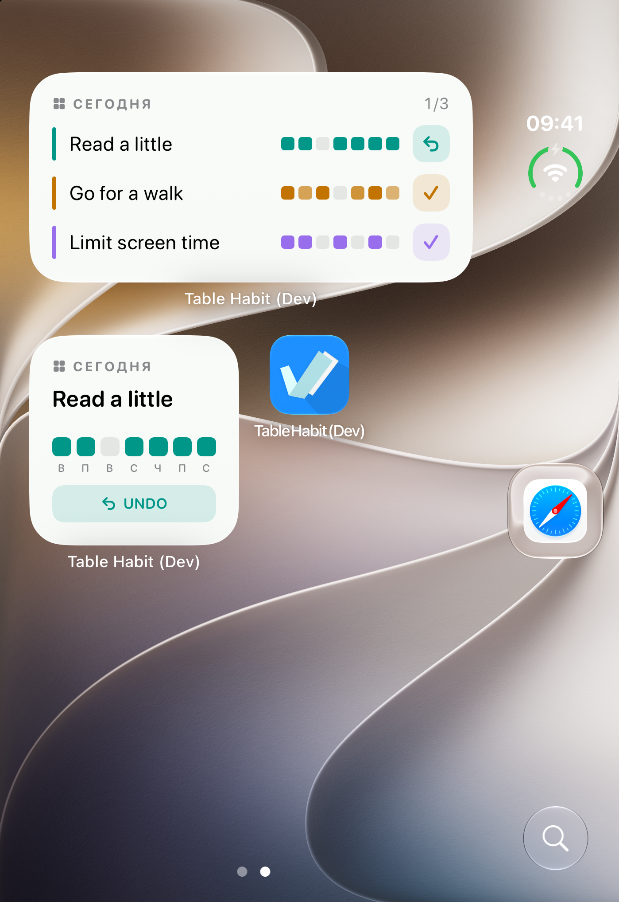
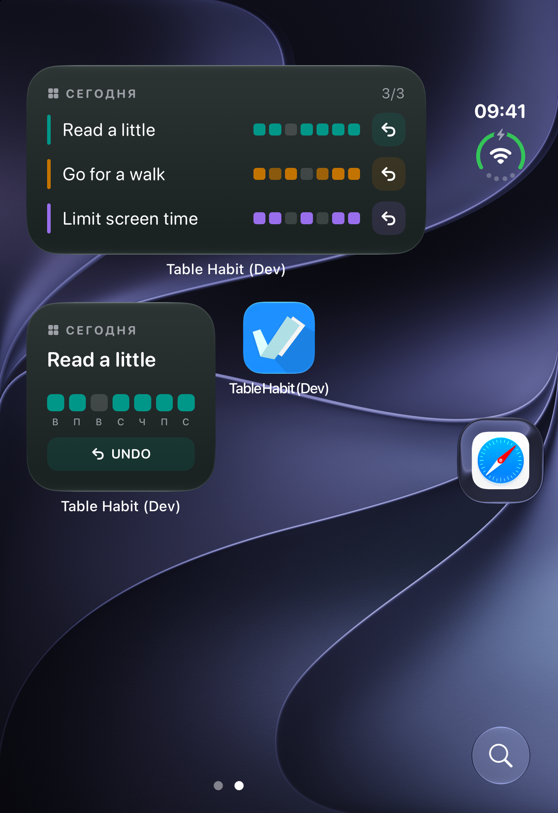

# Interactive iOS widgets

The small widget shows one habit and its last seven days. The medium widget
shows the first three active habits in their stored order. Complete today's
goal or undo a check-in without opening the app. Numeric habits are completed
to their configured goal; the app remains the place to enter a custom value.

Widgets require iOS 17 or later. The main application still supports iOS 15.
After a day or time-zone change, use the widget's refresh button to load the
current day without opening the app. An outdated button refreshes the snapshot
instead of modifying a different day or overwriting a newer record.

## Building

Use the repository's pinned Flutter SDK and `make bootstrap`. In Xcode, select
your development team for both `Runner` and `HabitWidgetExtension`. Register the
App Group for the build variant and enable it for both targets:

| Variant | App bundle ID | Shared App Group |
| --- | --- | --- |
| default / `f_generic` | `io.github.friesi23.mhabit` | `group.io.github.friesi23.mhabit.widgets` |
| `f_dev` | `io.github.friesi23.mhabit.dev` | `group.io.github.friesi23.mhabit.dev.widgets` |
| `f_store` | `io.github.friesi23.mhabit.store` | `group.io.github.friesi23.mhabit.store.widgets` |

The extension bundle ID is the app bundle ID followed by `.widgets`. When
changing the app identifier for a fork, update the corresponding App Group and
provisioning profiles as well. Distribution needs profiles for the app and its
extension; the existing Fastlane lane includes both targets.

Runner sets `ENABLE_APPINTENTS_DEPLOYMENT_AWARE_PROCESSING=NO` so its iOS 15
deployment target still produces usable iOS 17 intent metadata. This follows
[Apple's compatibility workaround](https://developer.apple.com/jp/documentation/xcode-release-notes/xcode-15_3-release-notes).

```sh
.flutter/bin/flutter build ios --simulator --debug --flavor f_dev
```

Launch the app once, create or import habits, then add the Table Habit widget
from the Home Screen widget gallery. The App Group holds a display snapshot;
the existing application database remains the source of truth.

## How actions are saved

A Swift `AppIntent` runs in the app process without opening its interface. It
starts a dedicated headless Flutter engine at `habitWidgetBackgroundMain` and
waits for the Dart operation to finish. SQLite reads, revision checks, writes,
and sync dirty counters use the existing storage helpers. Undo creates the
same deletion marker used by the app; restoring a check-in preserves its UUID.
Reminder reconciliation and snapshot publication follow a successful commit.

Commands include the displayed date and a compact revision token. Stale,
duplicate, archived-habit, and malformed commands cannot overwrite newer data.
The token includes the record and its existing sync counters, so rapid
undo/redo within one second cannot make an old button current again.
The private action URI is not registered as an external URL scheme.

The foreground app republishes the snapshot after data, locale, and date
changes and reloads its cached views after a widget write. WebDAV uploads use
the existing sync workflow when the app next runs it.

## Simulator / device verification

- Check the small and medium layouts in light and dark appearance.
- Complete and undo a habit from the Home Screen; verify the app stays closed.
- Terminate the app process, then repeat the action from the widget and verify
  the saved record after relaunch. Test manual force-quit separately on a device.
- Check numeric and negative habits, repeated taps, and a stale widget after an
  in-app edit or archive.
- Refresh after midnight and a time-zone change; verify the correct local date.
- Verify reminder updates and a WebDAV round trip after a widget change.

Unit tests exercise the actual SQLite transaction and sync metadata, plus the
background method-channel acknowledgement. Validation for this change includes
2,897 passing tests from `make test`, full Dart analysis with no issues, and a successful
`f_dev` simulator debug build with the pinned Flutter SDK and Xcode 27.1.

Verified on an iPhone Duo simulator running iOS 27.1:

- Completing a habit in the small widget refreshed both widget sizes without
  opening the app. Undo in the medium widget saved a tombstone and incremented
  the sync dirty counter.
- After terminating the app process, completing the numeric habit changed
  10/30 to 30/30 through a newly started background process, without opening
  the app UI. Numeric undo and a negative habit's configured goal also saved.
- Reopening the app showed the saved data. Completing the remaining habits
  brought the widget total to 3/3.
- Both sizes render in light and dark appearance; dark action labels use the
  primary text color to maintain contrast against the habit-colored background.

Physical-device force-quit, reminder delivery, a WebDAV round trip, and live
midnight/time-zone changes remain manual checks. Stale-date protection is
covered by unit tests.

## Simulator screenshots

Real Home Screen captures with synthetic habits, before and after completing
the first habit, and after completing all three in dark appearance:

| Before: 0/3 | After: 1/3 | Dark: 3/3 |
| --- | --- | --- |
|  |  |  |
